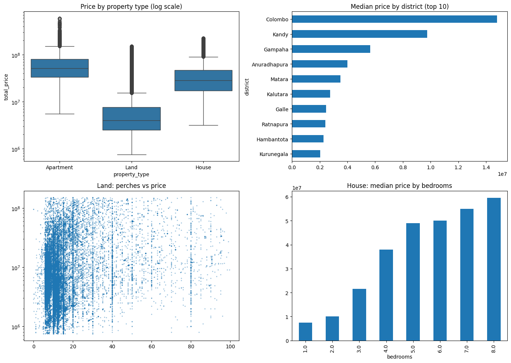
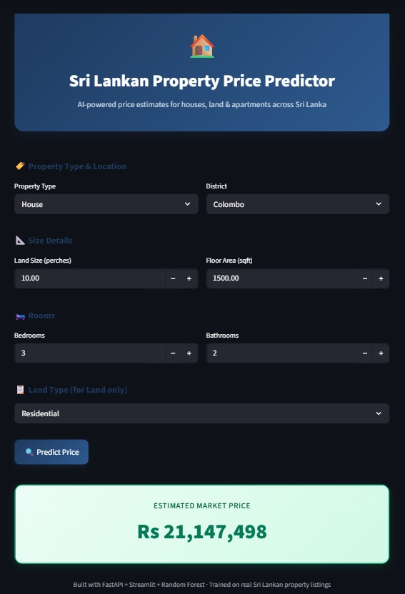

# 🏠 Sri Lankan Property Price Predictor

An end-to-end machine learning project that predicts property prices (houses, land, and apartments) across Sri Lanka, built on real listings data. Includes data cleaning, feature engineering, model training, a FastAPI backend, and a Streamlit web app.

## 🔗 Live Demo & Model Files

- **Demo video / screenshots:** see below
- **Pre-trained model files** (too large for GitHub, hosted on Google Drive):
  - [rf_model.pkl](https://drive.google.com/file/d/1xk63f_MTT3HWCPHmrHSZKIEEer4mh2ly/view?usp=sharing)
  - [model_columns.pkl](https://drive.google.com/file/d/18zDkxAPR-J2D00qybJ3Hnw5WXLxhCn9_/view?usp=drive_link)

## 📊 Problem

Property prices in Sri Lanka vary enormously depending on district, size, and property type, and buyers/sellers have little data-driven way to estimate a fair price. This project builds a Random Forest model trained on ~150,000 real property listings to generate instant price estimates.

## 🗂️ Data Source

- [Sri Lanka Property Ads Dataset (Kaggle)](https://www.kaggle.com/datasets/ivantha/sri-lanka-property-ads-dataset) — 200,000+ real ikman.lk property advertisements.

## 🧹 Data Cleaning & Feature Engineering

- Filtered to **for-sale** listings only (removed rentals)
- Parsed messy price text (`"Rs 59,500,000"`, `"Rs 1,600,000 per perch"`) into numeric values, converting per-perch land prices into total prices
- Extracted bedrooms, bathrooms, land size (perches), and floor area (sqft) from nested JSON-like fields
- Extracted district from location data
- Removed outliers (top/bottom 1% of prices per property type) and duplicate listings
- Final dataset: **149,635 clean listings**, 10 features

## 📈 Exploratory Data Analysis

| Property Type | Median Price |
|---|---|
| Apartment | Rs 52,000,000 |
| House | Rs 28,500,000 |
| Land | Rs 3,990,000 |

Key findings:
- Colombo and Kandy have the highest median prices
- House prices scale strongly with bedrooms and floor area
- Land prices vary widely even within the same perch range, suggesting location/road-access factors not captured in this dataset

## 🤖 Model

Two models were trained and compared:

| Model | MAE | R² |
|---|---|---|
| Linear Regression | Rs 8,461,722 | 0.703 |
| **Random Forest** | **Rs 5,256,807** | **0.810** |

Per property-type performance (Random Forest):

| Type | R² | Strongest predictor |
|---|---|---|
| House | 0.797 | Bathrooms, floor area |
| Apartment | 0.728 | Floor area |
| Land | 0.523 | Land size, district |

**Limitation:** Land price predictions are less accurate, since the dataset doesn't capture road access, plot shape, or exact micro-location — factors that strongly affect land value in Sri Lanka.

## 🛠️ Tech Stack

- **Data processing:** Python, Pandas, NumPy
- **Modeling:** Scikit-learn (Random Forest, Linear Regression)
- **Backend API:** FastAPI
- **Frontend:** Streamlit
- **Development:** Google Colab, VS Code

## 🚀 Running Locally

1. Clone this repo:
```
   git clone https://github.com/sirimanna2002/sl-property-price-predictor.git
   cd sl-property-price-predictor
```
2. Download `rf_model.pkl` and `model_columns.pkl` from the Drive links above and place them in the project folder.
3. Install dependencies:
```
   pip install fastapi uvicorn scikit-learn joblib pandas streamlit requests
```
4. Start the backend (terminal 1):
```
   uvicorn main:app --reload
```
5. Start the frontend (terminal 2):
```
   streamlit run app.py
```
6. Open the Streamlit app in your browser and get instant price predictions.

## 📸 Screenshots

### Exploratory Data Analysis


### App Demo


## 👤 Author

Malsha — [LinkedIn](https://www.linkedin.com/in/malsha-nethmini-vk/) · [GitHub](https://github.com/sirimanna2002)